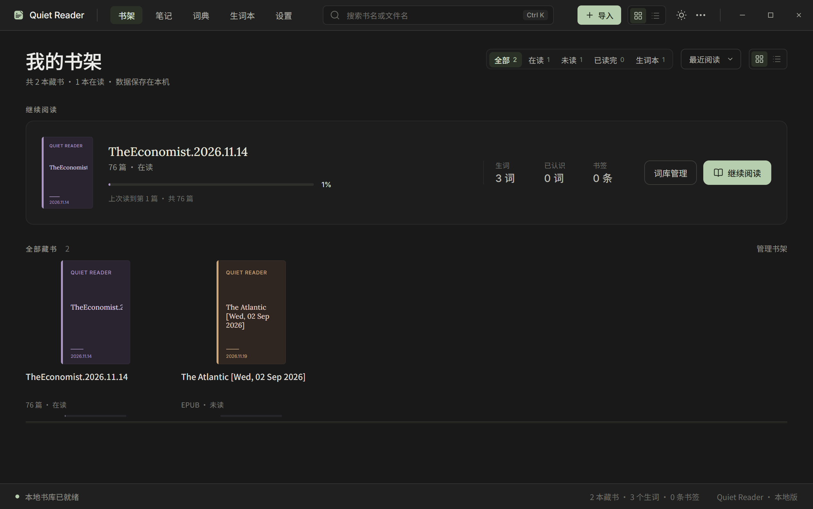
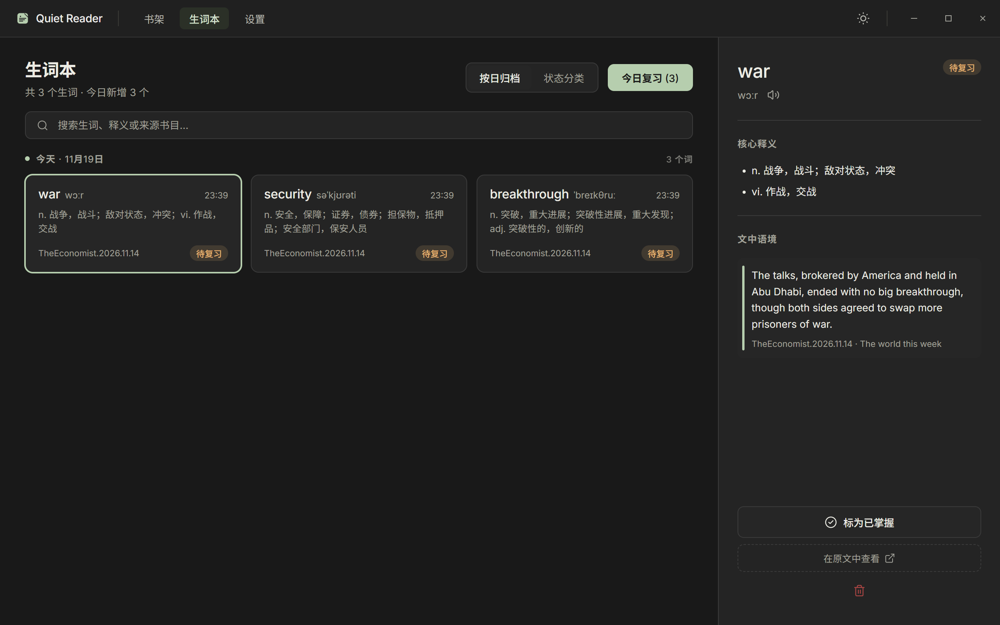
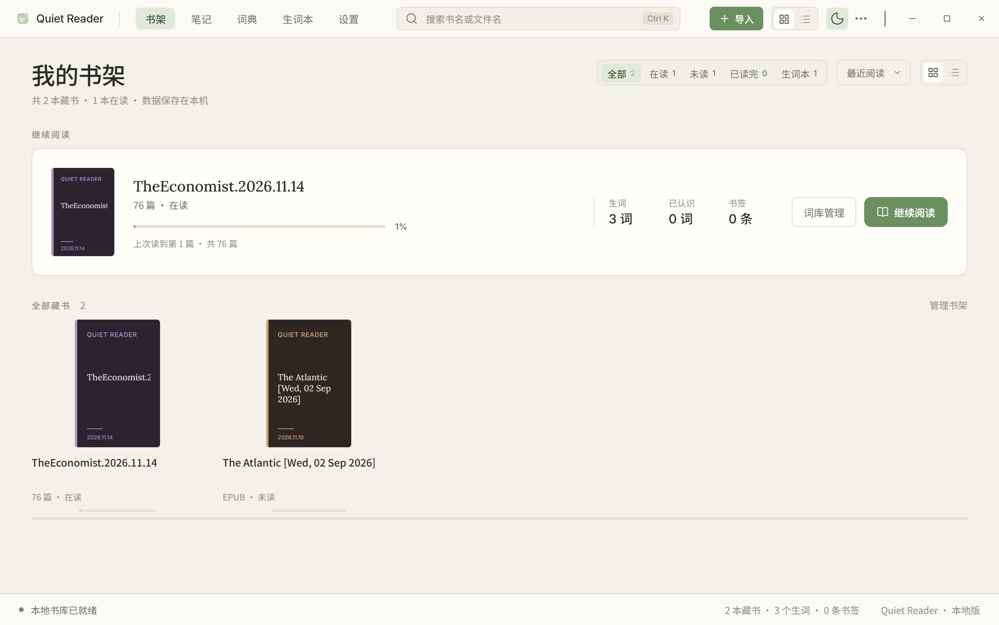
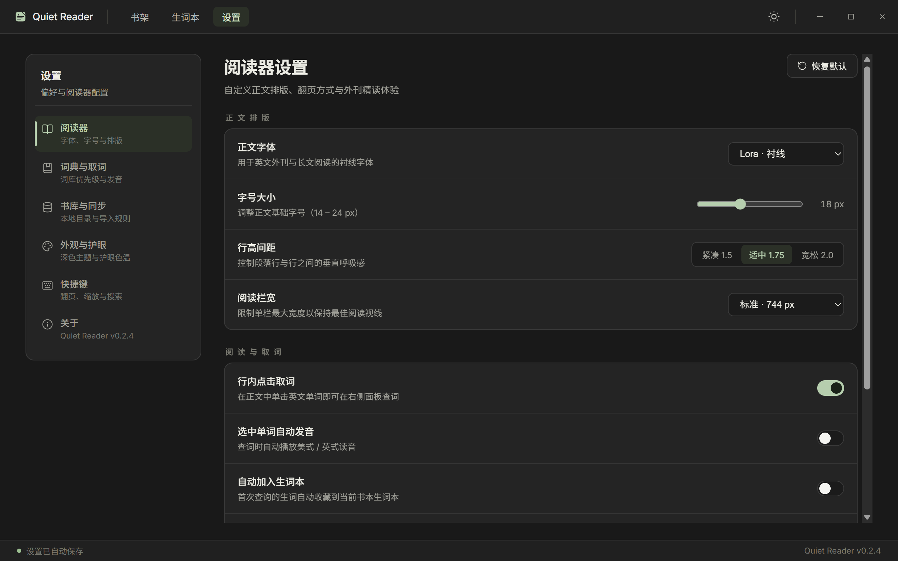

<div align="center">

# Quiet Reader · 静读

**本地优先的 EPUB 外刊精读桌面应用**

导入《经济学人》等外刊的 EPUB，按文章阅读、点词即查、一键收进生词本，并同步到 Anki。

Tauri v2 · React 19 · TypeScript · Vite

</div>



## 这是什么

Quiet Reader 是一个只为「精读外刊」而做的桌面阅读器。它不试图成为万能阅读软件，而是把外刊阅读里最耗神的几步——**找到文章、看懂句子、记住生词、复习**——做顺：

- 打开一本外刊 EPUB，书架按封面和阅读进度展示，导入后自动按 SHA-256 去重。
- 阅读视图自动识别一期的各篇文章，左右翻篇、按章跳转、整篇搜索。
- 点击任意单词，右侧面板给出音标、发音、核心释义、**文中的原句语境**，以及词表里的考纲标记。
- 生词一键加入生词本，按日期归档、按状态筛选，随时标记「已掌握」。
- 通过 AnkiConnect 把生词（连同原句和出处）导出到 Anki 牌组，回到原书继续读。

所有书籍、生词、设置都存在本机，不上传任何数据。

## 功能

### 阅读

- 三栏布局：左侧文档导航（大纲 / 书签）、中间正文、右侧取词面板，可固定或自动收起。
- 无边框一体化顶栏：书架 / 生词本 / 设置三个入口，右侧自绘窗口按钮。
- 排版：Lora 衬线正文 + Inter 界面字体，字号、行距、页边距可调，支持适合宽度与 50%–200% 缩放。
- 阅读进度按书保存，下次打开回到上次位置。
- 当前文章内搜索，`Enter` 逐个跳转并高亮。


### 取词与词典

- 点词即查，内置 7 套词表插件（考研红宝书 2025/2026、CET-4、CET-6、雅思、托福、GRE），可在设置里启停并调整优先级。
- 词形还原（`brokered` → `broker`）来自 ECDICT 的 lemma 词表，变形词也能命中。
- 释义优先取本地权威词典缓存，缺失时按需在线查找并缓存到本地。
- 面板展示音标、发音、核心释义、文中语境、常见搭配；可一键加入生词本或导出。

### 生词本

- 按日期归档 / 按状态分类两种视图。
- 单词卡片显示释义摘要、来源书目与收录时间。
- 详情面板支持朗读、跳回原文中的位置、标记已掌握。
- 「今日复习」一键筛出当天新增的词。



### Anki 同步

- 通过 [AnkiConnect](https://ankiweb.net/shared/info/2055492159)（add-on 代码 `2055492159`）连接本机 Anki，默认地址 `http://127.0.0.1:8765`。
- 默认目标牌组 `考研英语词汇::单词::生词组`，可自定义。
- 卡片字段带原句与出处（如 *TheEconomist.2026.11.14 · The world this week*）。
- **引用已有牌组**：可把词条直接放进你已经在用的牌组，而不是新建一个，避免牌组碎片化。
- 导出前用 `findCards` 去重，重复导出不会产生重复卡片。

### 外观

- 8 套主题（深色 4 套、浅色 4 套），默认「静读 · 墨绿」，深色 / 浅色偏好分别记忆。
- 暖色护眼模式与阅读区背景色独立于界面主题。





## 快速开始

### 环境要求

- Windows 10/11（当前主要在 Windows 上开发与打包，WebView2 运行时随安装包处理）
- Node.js 20+
- Rust stable（MSVC toolchain）
- 打包需要 Visual Studio Build Tools 的「使用 C++ 的桌面开发」组件

### 开发

```bash
npm install
npm run tauri dev
```

只调前端时可以跑 `npm run dev`，地址是 http://localhost:1420 ；但书库、Anki 转发、在线词典等能力只在 Tauri 窗口里可用，浏览器预览会自动降级。

### 测试

```bash
npm test          # Vitest，56 个用例
cd src-tauri && cargo test
```

### 构建安装包

```bash
npm run tauri build
```

产物：

- 可执行文件 `src-tauri/target/release/quiet-reader.exe`（实际文件名跟随 `productName`）
- MSI / NSIS 安装包 `src-tauri/target/release/bundle/`

### 词表

`public/plugins/` 里的词表是预先生成好的。需要重新生成时：

```bash
npm run plugins
```

脚本会从 qwerty-learner 与 ECDICT 拉取源文件（缓存在 `.scratch/dicts`），归一化后写入 `public/plugins`。

## 使用说明

1. **导入书籍**：书架右上角「导入」，选择 EPUB。文件按内容哈希存入本地书库，重复导入同一本书不会产生副本。
2. **开始阅读**：点封面进入阅读视图；顶栏中间切换文章，`Ctrl + F` 搜索当前文章。
3. **查词**：点击正文中的单词，右侧面板出现释义与语境。
4. **收词**：在右侧面板点「加入生词本」。
5. **复习**：顶栏「生词本」查看、筛选、标记掌握。
6. **同步 Anki**：先在 Anki 中安装 AnkiConnect 并保持 Anki 运行，然后在阅读视图右上角的导出按钮或「更多 → 导出 Anki」中导出。设置 → 词典与取词 里可以改 AnkiConnect 地址和目标牌组。

### 快捷键

| 快捷键 | 作用 |
| --- | --- |
| `Ctrl + F` | 搜索当前文章 |
| `Ctrl + +` / `Ctrl + -` | 放大 / 缩小 |
| `Enter` | 搜索时跳到下一个匹配 |
| `Esc` | 关闭搜索或弹出菜单 |

### 数据存储位置

| 内容 | 位置 |
| --- | --- |
| 书库文件与清单 | `%APPDATA%\com.dtai.pdfreader\library\` |
| 词典缓存 | 同一应用数据目录下 |
| 生词、阅读进度、设置 | 本地 IndexedDB / localStorage（WebView2 用户数据目录） |

卸载应用不会自动删除这些数据，需要清理时手动删除上面的目录。

## 项目结构

```text
.
├── src/                       # 前端（React + TS）
│   ├── App.tsx                # 路由式视图切换、全局状态、快捷键
│   ├── components/
│   │   ├── Topbar.tsx         # 一体化顶栏、Logo、自绘窗口按钮
│   │   ├── Bookshelf.tsx      # 书架
│   │   ├── Toolbar.tsx        # 阅读视图工具栏
│   │   ├── Reader.tsx         # 正文排版与点词
│   │   ├── OutlinePanel.tsx   # 左侧文档导航
│   │   ├── WordPanel.tsx      # 右侧取词面板
│   │   ├── VocabularyPage.tsx # 生词本
│   │   ├── SettingsPage.tsx   # 设置
│   │   ├── PluginManager.tsx  # 词表插件管理
│   │   └── ThemeManager.tsx   # 主题选择
│   ├── lib/
│   │   ├── epub.ts            # EPUB 解析与文章切分
│   │   ├── shelf.ts           # 书架数据与进度
│   │   ├── library.ts         # 本地书库（Rust 命令封装）
│   │   ├── dict.ts            # 词典与词表匹配
│   │   ├── onlineDict.ts      # 在线词典
│   │   ├── wordbook.ts        # 生词本
│   │   ├── anki.ts            # Anki 卡片生成
│   │   ├── ankiConnect.ts     # AnkiConnect 调用
│   │   └── themes.ts          # 主题 token
│   └── *.css                  # styles / bookshelf / settings / vocabulary / theme
├── src-tauri/                 # 桌面端（Rust）
│   ├── src/lib.rs             # 应用入口与命令注册
│   ├── src/library.rs         # 书库读写、SHA-256 去重
│   ├── src/anki.rs            # AnkiConnect 请求转发（绕开 CORS）
│   ├── src/dict_fetch.rs      # 在线词典抓取与缓存
│   ├── tauri.conf.json        # 窗口：无边框、默认最大化 1280×800
│   └── capabilities/default.json
├── public/plugins/            # 内置词表（JSON）与清单
├── scripts/build-plugins.mjs  # 词表生成脚本
├── docs/
│   ├── screenshots/           # README 截图
│   ├── design/                # Figma 顶栏设计导出
│   └── superpowers/           # 设计文档与实现计划
└── index.html
```

更细的设计与实现记录见：

- [MVP 设计文档](docs/superpowers/specs/2026-11-19-quiet-reader-mvp-design.md)
- [实现计划](docs/superpowers/plans/2026-11-19-quiet-reader-mvp.md)
- [顶栏设计稿导出](docs/design/bookshelf-node.json)

## 实现要点

- **无边框窗口**：`decorations: false`，整条顶栏是 `data-tauri-drag-region`，最小化 / 最大化 / 关闭由前端调用 `getCurrentWindow()` 完成，能力声明在 `src-tauri/capabilities/default.json`。
- **书库去重**：导入时计算内容 SHA-256，文件名即哈希；`library.json` 记录标题、路径、大小、导入时间，启动时与目录对账。
- **AnkiConnect 走 Rust**：AnkiConnect 的 CORS 白名单不含 `tauri.localhost`，浏览器直连会被拦，因此桌面端统一由 Rust 侧 `anki_invoke` 转发。
- **词典择优**：本地权威词典缓存优先，未命中再在线查询，结果落盘缓存；词形还原保证变形词同样命中。

## 第三方资源与许可

- 词表来源：[RealKai42/qwerty-learner](https://github.com/RealKai42/qwerty-learner)。仓库为 GPL-3.0；**词表内容版权归原出版方，仅供个人学习使用**，本项目未对其主张任何权利。
- 词形还原表：[skywind3000/ECDICT](https://github.com/skywind3000/ECDICT) 的 `lemma.en.txt`，文件声明可用于研究 / 教育用途。
- 字体：[Lora](https://fonts.google.com/specimen/Lora)、[Inter](https://fonts.google.com/specimen/Inter)，SIL Open Font License 1.1，通过 `@fontsource` 打包。
- 图标：[Lucide](https://lucide.dev)，ISC License。
- 详见 [public/plugins/README.md](public/plugins/README.md)。

## 状态

早期可用版本（v0.2.4），主要面向个人在 Windows 上的外刊精读场景，尚未做 macOS / Linux 适配，也没有自动更新。

代码许可证尚未选定。在补充 LICENSE 之前，默认保留所有权利；如果计划公开分发，建议在上传前选定（MIT 或 GPL-3.0 都是常见选择，注意 GPL-3.0 词表来源带来的兼容性讨论）。
